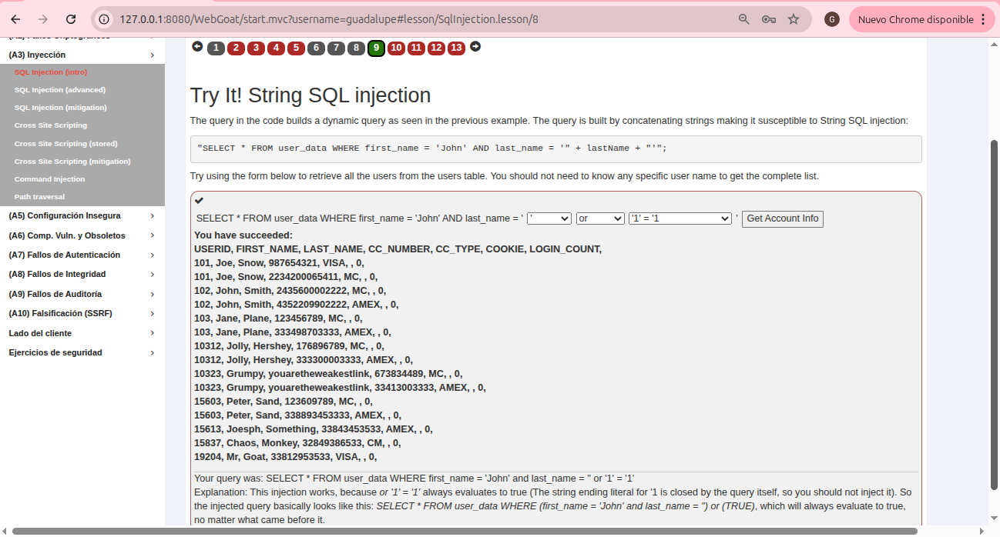
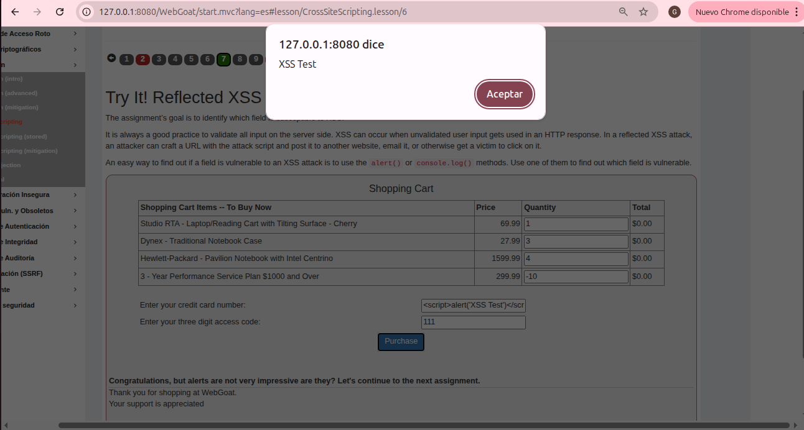
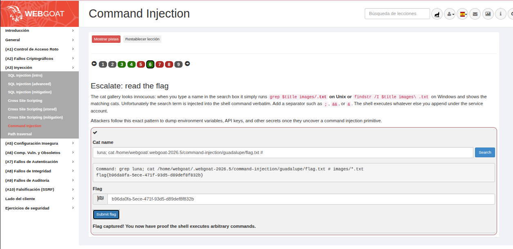
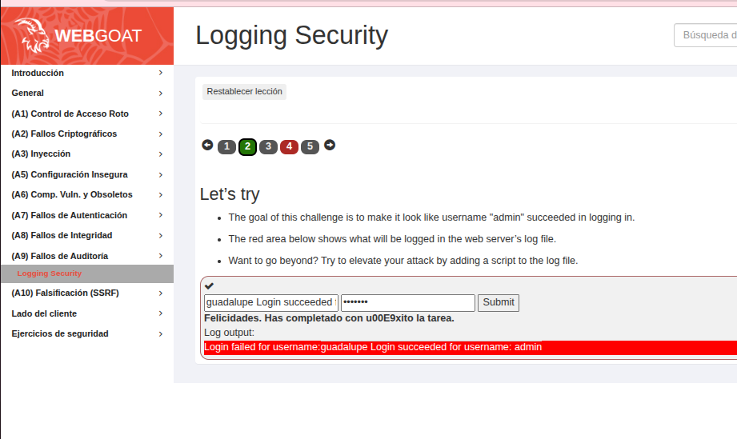
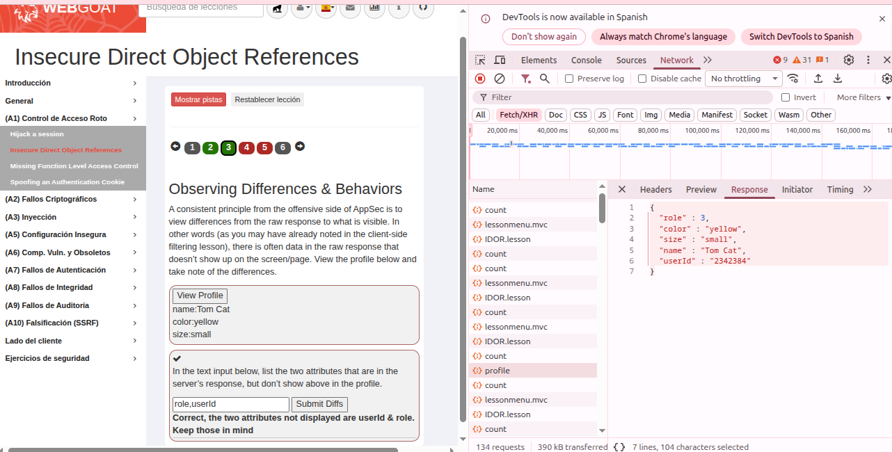
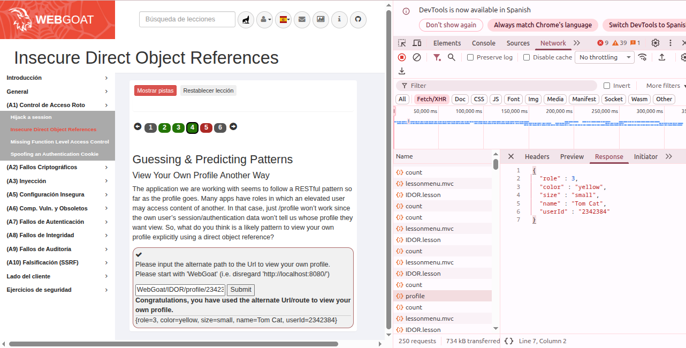

# TP 1: Seguridad OWASP con WebGoat

[WebGoat](https://owasp.org/www-project-webgoat/) es una aplicación web **vulnerable a propósito**, creada por OWASP para aprender a explotar (y así entender cómo prevenir) las vulnerabilidades más comunes. Cada lección explica una vulnerabilidad y propone ejercicios. Cuando el ataque funciona, el ejercicio se marca en verde.

## Cómo lo levanté

Lo corrí con Docker. Los puertos quedan atados a `127.0.0.1`, para que la aplicación vulnerable no quede expuesta a la red:

    docker run -d --name webgoat -p 127.0.0.1:8080:8080 -p 127.0.0.1:9090:9090 webgoat/webgoat

Las veces siguientes alcanza con volver a prender el mismo contenedor, que conserva el progreso:

    docker start webgoat

Después entré a http://127.0.0.1:8080/WebGoat y me registré con un usuario propio.

> WebGoat usa el puerto 8080, igual que la app JHipster del TP 3, así que no pueden correr al mismo tiempo. Para pasar de uno a otro uso `docker stop webgoat` / `docker start webgoat`.

## Resumen de los ataques

| # | Ataque | Categoría OWASP Top 10 2025 | Menú de WebGoat | Lección |
|---|--------|-----------------------------|-----------------|---------|
| 1 | SQL Injection | A05 Inyección | (A3) Inyección → SQL Injection (intro) | 9 |
| 2 | Cross-Site Scripting reflejado | A05 Inyección | (A3) Inyección → Cross Site Scripting | 7 |
| 3 | Command Injection | A05 Inyección | (A3) Inyección → Command Injection | 6 |
| 4 | Inyección de logs | A09 Fallas en el Registro, Alerta y Monitoreo | (A9) Fallos de Auditoría → Logging Security | 2 |
| 5 | Insecure Direct Object References (IDOR) | A01 Pérdida de Control de Acceso | (A1) Control de Acceso Roto → IDOR | 3 y 4 |

El menú de WebGoat todavía usa la numeración del Top 10 2021 (por ejemplo, "(A3) Inyección"). En la tabla agregué la categoría equivalente del Top 10 2025, que es la que vimos en clase.

---

## 1. SQL Injection

### Qué es

Una **inyección SQL** ocurre cuando la aplicación arma una consulta a la base de datos **concatenando texto que escribe el usuario**. Si ese texto contiene caracteres especiales de SQL (como la comilla `'`), el atacante puede "cerrar" el dato y agregar sus propias condiciones u órdenes. La base de datos no distingue qué parte escribió el programador y qué parte el atacante: ejecuta todo.

Con esto se pueden leer datos de otros usuarios, saltear un login, modificar o borrar tablas.

**Cómo se previene:** con **consultas parametrizadas** (*prepared statements*), donde el dato del usuario se pasa aparte y nunca se interpreta como SQL. También ayudan la validación de entradas y que el usuario de la base tenga solo los permisos mínimos.

### Cómo lo hice

En la lección 9 (*Try It! String SQL injection*), la aplicación arma esta consulta:

```java
"SELECT * FROM user_data WHERE first_name = 'John' AND last_name = '" + lastName + "'"
```

El objetivo era traer **todos** los usuarios de la tabla sin conocer ningún apellido. En el formulario elegí `'` , `or` y `'1' = '1`, con lo que la consulta quedó así:

```sql
SELECT * FROM user_data WHERE first_name = 'John' AND last_name = '' or '1' = '1'
```

La primera comilla cierra el apellido vacío, y `or '1' = '1'` agrega una condición que **siempre es verdadera**. Por eso el `WHERE` se cumple para todas las filas y la aplicación devolvió la tabla completa, **incluidos los números de tarjeta de crédito** de todos los usuarios.

**Evidencia:**



---

## 2. Cross-Site Scripting (XSS) reflejado

### Qué es

**XSS** es un tipo de inyección en el que el atacante logra que el **navegador de la víctima ejecute JavaScript** dentro de la página. Pasa cuando la aplicación toma algo que escribió el usuario y lo devuelve en la respuesta **sin escaparlo**, así que el navegador lo interpreta como código y no como texto.

En el XSS **reflejado**, el script viaja en el pedido (por ejemplo, en un parámetro de un formulario o de un link) y el servidor lo "refleja" en la respuesta. Un atacante puede armar un link con el script y enviárselo a la víctima. Al abrirlo, el código corre con la sesión de la víctima y puede robar cookies, hacer acciones en su nombre o modificar la página.

**Cómo se previene:** **escapando la salida** según el contexto (HTML, atributo, JavaScript), validando las entradas en el servidor y usando una **Content Security Policy (CSP)** que impida ejecutar scripts inline.

### Cómo lo hice

En la lección 7 (*Try It! Reflected XSS*) hay un carrito de compras, y el objetivo era descubrir qué campo es vulnerable. La forma más simple de probarlo es con `alert()`. En el campo **"Enter your credit card number"** escribí:

```html
<script>alert('XSS Test')</script>
```

Al apretar **Purchase**, el servidor devolvió el número de tarjeta dentro de la respuesta sin escaparlo, y el navegador **ejecutó mi script**: apareció la ventana *"127.0.0.1:8080 dice: XSS Test"*. Eso demuestra que en ese campo se puede ejecutar cualquier código JavaScript.

**Evidencia:**



---

## 3. Command Injection

### Qué es

La **inyección de comandos** es parecida a la inyección SQL, pero el intérprete es el **sistema operativo**. Ocurre cuando la aplicación arma un comando de consola concatenando texto del usuario y lo ejecuta con una shell. Con separadores como `;`, `&&` o `|`, el atacante puede agregar **sus propios comandos**, que corren con los permisos del servidor.

Es de las más graves: permite leer archivos, ver variables de entorno con claves y contraseñas, instalar programas o tomar el control del servidor.

**Cómo se previene:** no pasar datos del usuario a una shell. Usar las funciones del lenguaje en lugar de comandos externos o, si no queda otra, pasar los argumentos como una lista (sin shell) y validarlos contra una **lista de valores permitidos**. El proceso también debería correr con los permisos mínimos.

### Cómo lo hice

En la lección 6 (*Escalate: read the flag*) hay una galería de gatos con un buscador. Por detrás, la aplicación ejecuta:

```bash
grep $title images/*.txt
```

donde `$title` es lo que escribo en el buscador, sin ningún filtro. El objetivo era leer un archivo secreto (la *flag*). En el campo **Cat name** escribí:

```
luna; cat /home/webgoat/.webgoat-2026.5/command-injection/guadalupe/flag.txt #
```

- `luna` es una búsqueda normal.
- `;` termina el comando `grep` y empieza uno nuevo.
- `cat .../flag.txt` es **mi comando**: muestra el contenido del archivo secreto.
- `#` convierte en comentario el resto del comando original (`images/*.txt`), para que no moleste.

El servidor ejecutó `grep luna; cat .../flag.txt # images/*.txt` y en la respuesta apareció la flag `flag{b96da0fa-5ece-471f-93d5-d89def8f832b}`. La envié y WebGoat confirmó: *"Flag captured! You now have proof the shell executes arbitrary commands."*

**Evidencia:**



---

## 4. Inyección de logs (Logging Security)

### Qué es

Los logs son la **evidencia** de lo que pasó en un sistema: se usan para investigar incidentes, auditar accesos y detectar ataques. La **inyección de logs** (CWE-117) ocurre cuando la aplicación escribe en el log texto del usuario sin limpiarlo. Así el atacante puede **agregar líneas falsas** (por ejemplo, con saltos de línea `\r\n`), confundir a quien investiga, tapar sus huellas o hasta meter código que se ejecute cuando alguien vea el log en una herramienta web.

Está dentro de **A09: Fallas en el Registro, Alerta y Monitoreo**: si los logs no son confiables, un ataque puede pasar desapercibido.

**Cómo se previene:** **neutralizando los caracteres de control** (sobre todo `\r` y `\n`) antes de escribir en el log, usando logs estructurados en JSON, donde cada dato va en su propio campo, y escapando el contenido al mostrarlo. Por ejemplo, la app JHipster del TP 3 trae un `CRLFLogConverter` que reemplaza los saltos de línea de los mensajes.

### Cómo lo hice

En la lección 2 (*Let's try*), el objetivo era que en el log pareciera que el usuario **admin** había iniciado sesión con éxito. Cuando el login falla, la aplicación escribe:

```
Login failed for username: <lo que escribí como usuario>
```

En el campo de usuario escribí:

```
guadalupe Login succeeded for username: admin
```

y cualquier contraseña. La aplicación copió mi texto tal cual en el log, así que la línea quedó así:

```
Login failed for username:guadalupe Login succeeded for username: admin
```

Quien lea ese log ve un **"Login succeeded for username: admin" que nunca ocurrió**. En un ataque real se agrega un salto de línea (`%0d%0a`) antes del texto falso para que aparezca como una línea separada e independiente. WebGoat dio el ejercicio por resuelto: *"Felicidades. Has completado con éxito la tarea."*

**Evidencia:**



---

## 5. Insecure Direct Object References (IDOR)

### Qué es

Una **referencia directa insegura a objetos** (IDOR) ocurre cuando la aplicación usa un identificador que el usuario puede ver y modificar (un ID en la URL, en un parámetro o en el JSON) para acceder a un recurso, **sin verificar que ese recurso le pertenezca**. Cambiando el ID, por ejemplo de `/profile/2342384` a `/profile/2342388`, el atacante puede ver o modificar datos de otros usuarios.

Es un caso típico de **A01: Pérdida de Control de Acceso**, el riesgo número 1 del Top 10.

**Cómo se previene:** **verificando en el servidor, en cada pedido, que el usuario tenga permiso sobre ese objeto en particular**, y no solo que haya iniciado sesión. Ayuda no exponer más datos de los necesarios en las respuestas y usar identificadores difíciles de adivinar (aunque eso solo no alcanza).

### Cómo lo hice

**Lección 3 (*Observing Differences & Behaviors*).** Al apretar **View Profile**, la página mostraba solo `name`, `color` y `size`. Abrí las herramientas de desarrollador de Chrome (F12 → **Network**) y miré la respuesta del pedido `profile`. El servidor en realidad mandaba más datos de los que se veían:

```json
{ "role": 3, "color": "yellow", "size": "small", "name": "Tom Cat", "userId": "2342384" }
```

Los dos atributos ocultos eran `role` y `userId`. Los ingresé (`role,userId`) y WebGoat confirmó: *"Correct, the two attributes not displayed are userId & role."* Esto ya es un problema: el servidor expone información interna (mi ID y mi rol) que el usuario no necesita.

**Evidencia:**



**Lección 4 (*Guessing & Predicting Patterns*).** Con el `userId` que encontré, había que adivinar otra ruta para ver el perfil **referenciando el objeto directamente por su ID**. Como la aplicación sigue un patrón REST, probé:

```
WebGoat/IDOR/profile/2342384
```

y funcionó: *"Congratulations, you have used the alternate Url/route to view your own profile."* Eso confirma que los perfiles se acceden por un ID predecible en la URL. Si el servidor no controla de quién es cada perfil, alcanza con cambiar ese número para ver el de otro usuario, que es justamente lo que propone la lección siguiente.

**Evidencia:**



---

## Conclusión

Tres de los cinco ataques (SQL, XSS y comandos) tienen la **misma causa**: la aplicación mezcla datos del usuario con código que después interpreta otro sistema (la base de datos, el navegador o la shell). La defensa también es la misma: **nunca confiar en la entrada** y separar siempre datos de código (consultas parametrizadas, escapado de la salida, no usar la shell).

El IDOR muestra que no alcanza con autenticar al usuario: hay que **autorizar cada acceso** a cada objeto. Y la inyección de logs muestra que hasta los registros de seguridad pueden ser atacados, lo que se conecta con el TP 3: logs estructurados y caracteres de control neutralizados.
